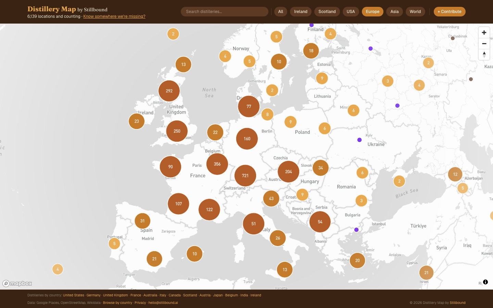

# Distillery Map

**Ask how many distilleries there are in the world and nobody can tell you. We believe this is the world's first open map of them: 6,139 distilleries and spirit producers in 141 countries, every one with its source.**

## Why I built it

The trade directories are paywalled, the Wikipedia lists are stale, and general maps can't tell a working still from a head office. I spent years in the drinks trade and never had a map I could trust. So I built one, put the source beside every pin, and made it free. It is the public layer of Stillbound, and the base its research stands on.

## What's under the hood

- **One inclusion rule.** A pin needs a physical address and something real at it. All spirits count, not just whiskey.
- **A source on every pin,** from Google Places, OpenStreetMap, Wikidata and curated research. Removals are logged with a reason.
- **Checked against company registers** in multiple countries, so a pin is tied to a real, active business.
- **Anyone can contribute.** Missing a distillery, or know one that closed? Add it from the map.

## Where it stands

Live and free at [distillerymap.org](https://distillerymap.org). The map data is free to use with credit. Source code: private.

---

Built by John Robinson · [Stillbound.ai](https://stillbound.ai)
